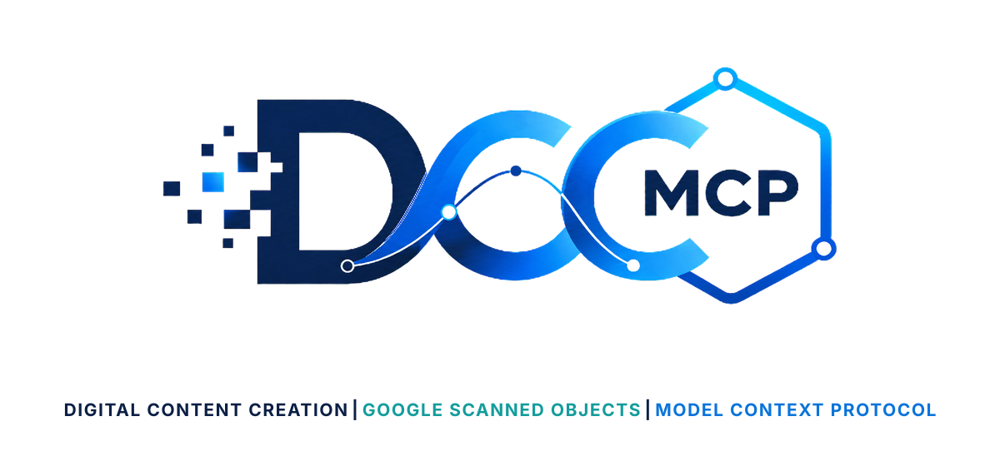
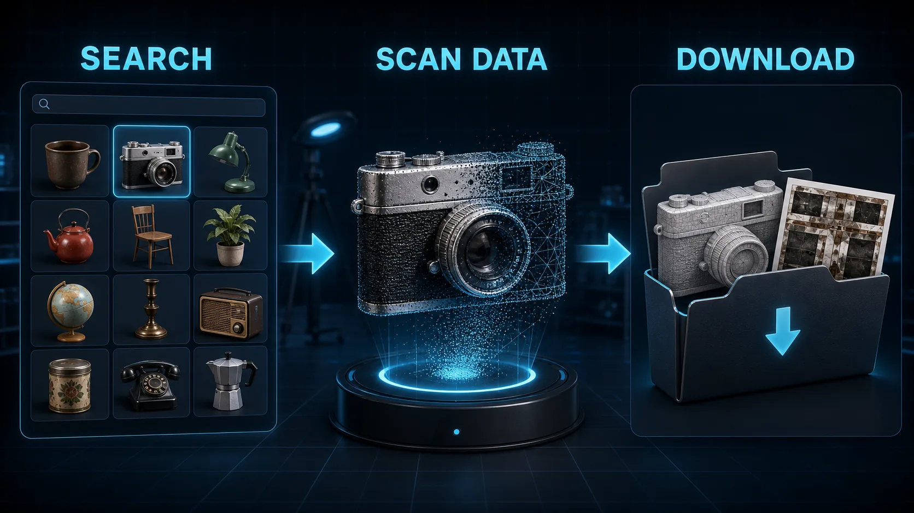

# DCC-MCP Google Scanned Objects

<p align="center">
  
</p>

## Agent workflow

AI agents should use installed package skills through the shared gateway. IDE
users may continue to use the MCP endpoint.

### Install or update the CLI

`dcc-mcp-cli` is the preferred control path for every shell-capable agent. If
it is missing, ask the user before installing the latest official release:

```bash
# Linux/macOS
curl -fsSL https://raw.githubusercontent.com/dcc-mcp/dcc-mcp-core/main/scripts/install-cli.sh | sh

# Windows PowerShell
powershell -ExecutionPolicy Bypass -c "irm https://raw.githubusercontent.com/dcc-mcp/dcc-mcp-core/main/scripts/install-cli.ps1 | iex"
```

Keep an official build current through the release manifest:

```bash
dcc-mcp-cli update check
dcc-mcp-cli update apply
```

`update apply` downloads and stages the latest CLI for the next launch. It
does not update a running `dcc-mcp-server`; update that server in its own
environment.

Choose one stable `<task-id>` for the task and pass it to every tool call with
`--agent-session-id`. This sets `_meta.agent_context.session_id`; reuse the same
ID in `stats --session-id` after the task.

```bash
dcc-mcp-cli dcc-types
dcc-mcp-cli list
dcc-mcp-cli search --query "<task>" --dcc-type <host>
dcc-mcp-cli describe <tool-slug>
dcc-mcp-cli call <tool-slug> --agent-session-id "<task-id>" --json '{"key":"value"}'
```

If the package skill is not active, call
`dcc-mcp-cli load-skill <skill-name> --dcc-type <host>`. After the task,
query `dcc-mcp-cli stats --range 24h --session-id "<task-id>"` and pass only
bounded evidence to the `review_skill_improvement` prompt from
`dcc-mcp-skills-creator`.




Google Scanned Objects search and download tools for DCC-MCP.

This skill uses Gazebo Fuel's public model API for the GoogleResearch owner.
It downloads the original SDF/OBJ/texture model files and does not import them
into a DCC scene.

## Install

```bash
dcc-mcp-cli marketplace add dcc-mcp/dcc-asset-google-scanned-objects
dcc-mcp-cli marketplace install dcc-asset-google-scanned-objects
```

## Tools

- `search_google_scanned_objects`
- `list_google_scanned_object_files`
- `download_google_scanned_object`

## License Notes

This wrapper is MIT licensed. Google Scanned Objects are distributed through
Gazebo Fuel under Creative Commons Attribution 4.0 International. Keep
attribution and source metadata with downloaded assets.
